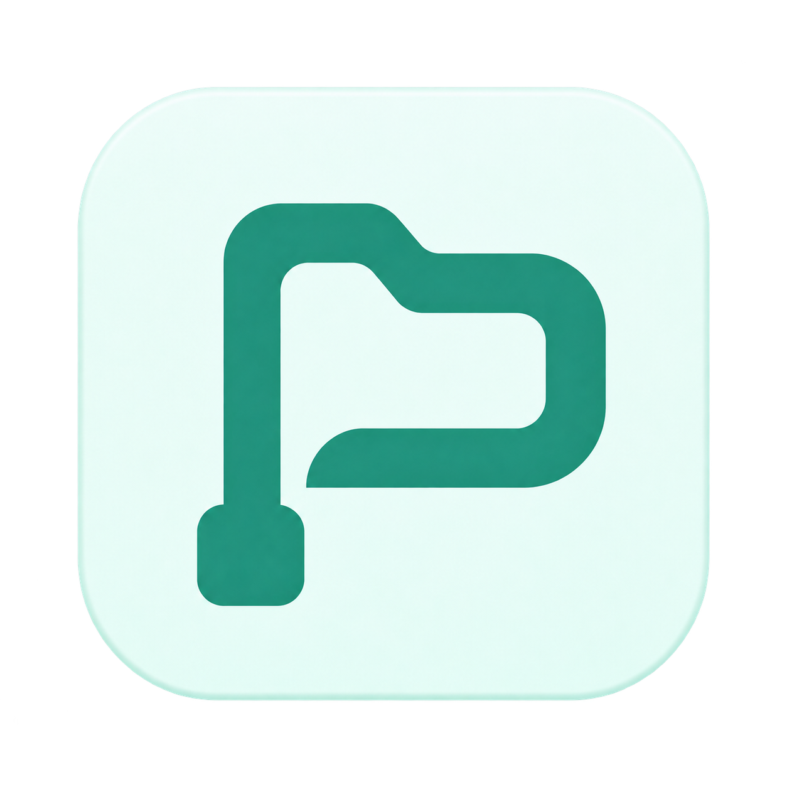
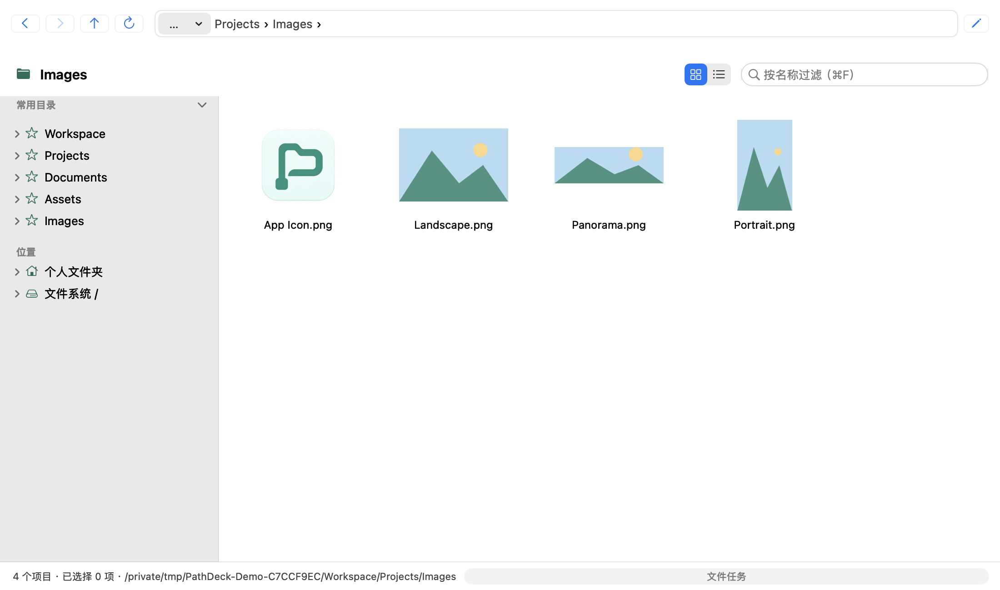
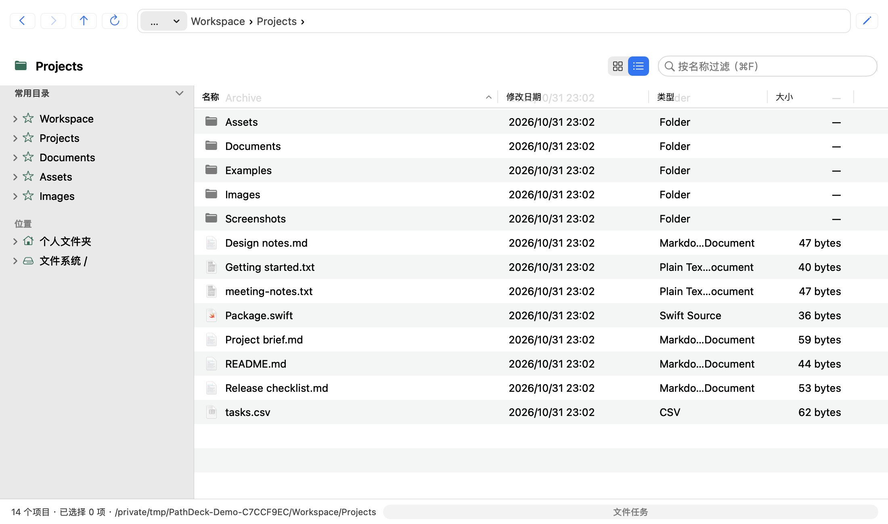
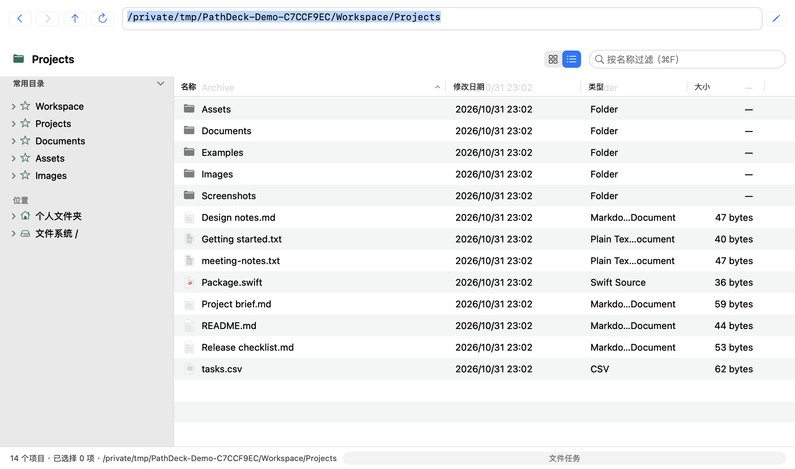
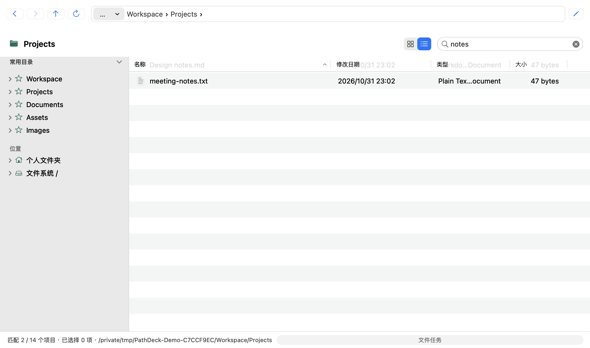
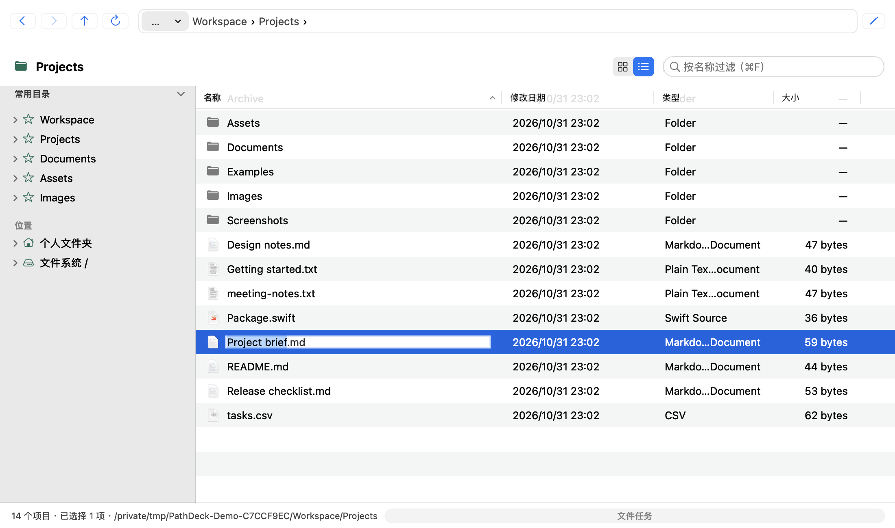
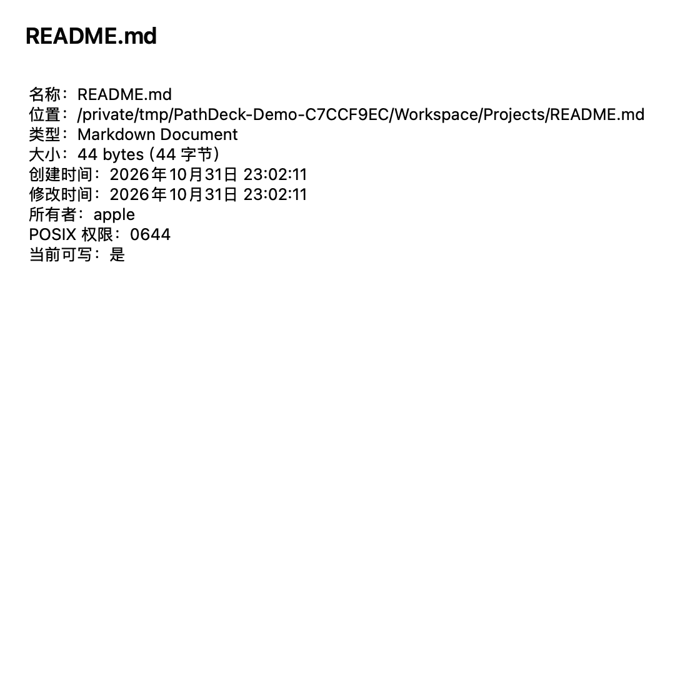
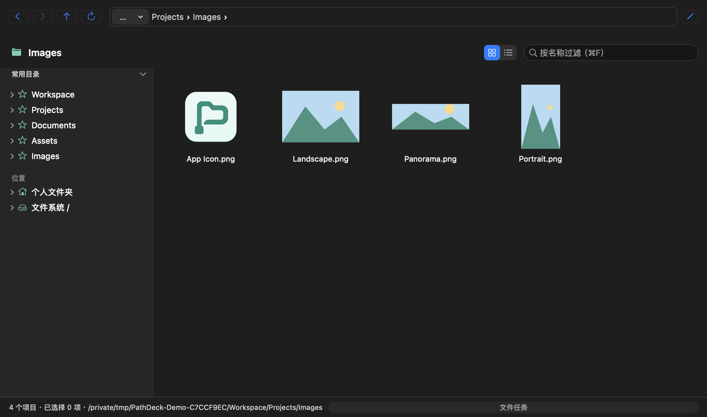

<p align="center">
  
</p>

<h1 align="center">PathDeck</h1>
<p align="center">看得清路径，用得惯操作。为 Mac 打造的原生文件工作区。</p>
<p align="center"><a href="README.md">English</a> · <strong>简体中文</strong></p>

PathDeck 是一款使用 **Swift + AppKit** 构建的 macOS 原生文件管理器。输入路径、跳转目录，继续手头的工作。它把可编辑的地址栏、常用右键操作和熟悉的 Windows 文件操作习惯带到 Mac，同时保留原生标签页、快速预览和浅色、深色外观。



*图片来自实际运行的 AppKit 界面，使用示例文件。应用界面目前为简体中文。*

## 功能

- **看图不用逐个打开。** 默认平铺显示图片缩略图、文件夹和文件图标；需要查看日期、大小等列信息时，可切回详情列表。每个标签分别记住显示方式。
- **输入路径，直接到达。** 在面包屑与路径输入之间切换，支持绝对路径、`~`、相对路径和本地 `file://` 地址。输入文件路径，会定位到父目录并选中文件。
- **让常用目录随手可达。** 目录树按需展开；常用目录可固定、设置显示别名和调整顺序。按名称过滤当前目录，快速缩小眼前的文件范围。
- **使用熟悉的文件操作。** 新建文件夹或文本、内联重命名、复制、剪切粘贴和移入废纸篓。右键即可在终端中打开目录，或用 VS Code 打开文件。
- **在不同位置间拖动文件。** 支持窗口、文件夹和标签页之间拖放，也可与访达互传文件。悬停标签上的文件夹图标即可切换该页，松手放入其目录。
- **给误操作留一条退路。** 撤销新建的空文件或空文件夹、重命名和移动。执行前检查文件身份与位置，避免误改后来被替换的文件。
- **重新打开，接着工作。** 恢复全部窗口、标签、目录、选中项、过滤条件、排序和列表布局。每个标签保留自己的浏览状态。
- **保留 Mac 的原生体验。** 空格快速预览、查看文件属性、键盘导航和列表密度切换；目录变化自动刷新，浅色、深色随系统切换。

## 界面一览

### 看图片用平铺，查信息用列表

点击过滤框旁的视图按钮切换，也可按 `⌘1` 显示平铺、`⌘2` 显示详情。缩略图随可见区域在后台加载，大图按预览尺寸解码。



### 路径看得见，也能直接输入

点击地址栏或按 `⌘L` 输入位置。面包屑显示目录层级，名称过滤帮你在当前目录里快速找到文件。

<table>
  <tr>
    <td width="50%"><br><strong>直接输入目录路径</strong></td>
    <td width="50%"><br><strong>过滤当前目录中的文件</strong></td>
  </tr>
</table>

### 常用操作就在文件旁边

在列表中直接改名，查看文件路径和权限，或交给其他应用打开。所有窗口共享文件任务队列，任务面板可查看结果或请求取消。

<table>
  <tr>
    <td width="66%" valign="top"><br><strong>留在列表里完成重命名</strong></td>
    <td width="34%" valign="top"><br><strong>查看文件详细信息</strong></td>
  </tr>
</table>

### 浅色与深色，保持原生手感

外观跟随系统，选择、焦点、滚动和文本编辑沿用原生控件的行为。



## 构建与使用

**环境要求：** macOS、带 macOS SDK 的 Swift 6 工具链，以及 Python 3。应用部署目标为 macOS 14 及以上，目前在 Apple Silicon 上开发和验证；运行时没有第三方依赖。

```bash
git clone https://github.com/jackie-cqz/PathDeck.git
cd PathDeck
bash scripts/build-app.sh release
open build/release/PathDeck.app
```

脚本会构建并进行本地签名，无需 Apple Developer 账号。需要长期使用时，将生成的 `PathDeck.app` 拖入“应用程序”即可。

也可以打开 `PathDeck.xcodeproj`，选择 **PathDeck / My Mac** 后运行。使用上述脚本时，可仅安装带 macOS SDK 的 Command Line Tools。

## 键盘快捷键

| 动作 | Mac | Windows 操作习惯下的文件列表 |
| --- | --- | --- |
| 平铺 / 详情 | `⌘1` / `⌘2` | 点击视图切换按钮 |
| 输入路径 | `⌘L` | `Ctrl+L` / `Alt+D` |
| 复制 / 剪切 / 粘贴 | `⌘C` / `⌘X` / `⌘V` | `Ctrl+C` / `Ctrl+X` / `Ctrl+V` |
| 撤销 | `⌘Z` | `Ctrl+Z` |
| 打开选中项 | `⌘↓` | `Enter` |
| 重命名 | 右键；关闭 Windows 操作习惯时可用 `Enter` | `F2` |
| 新建文件夹 | `⌘⇧N` | `Ctrl+Shift+N` |
| 移入废纸篓 | `⌘⌫` | 向前删除键（Forward Delete） |
| 过滤当前目录 | `⌘F` | `Ctrl+F` |
| 刷新 | `⌘R` | `F5` |
| 后退 / 前进 | `⌘[` / `⌘]` | `Alt+←` / `Alt+→` |
| 上一级 | `⌘↑` | `Alt+↑` |
| 新窗口 / 新标签 / 关闭 | `⌘N` / `⌘T` / `⌘W` | `Ctrl+N` / `Ctrl+T` / `Ctrl+W` |
| 切换标签 | `⌘⇧[` / `⌘⇧]` | `Ctrl+Shift+Tab` / `Ctrl+Tab` |
| 快速预览 | `Space` | `Space` |
| 属性 | `⌘I` | `Alt+Enter` |

在 PathDeck 菜单中切换 Windows 操作习惯。文件快捷键在列表获得焦点时生效；文本框保留正常编辑和文字撤销。Windows 模式下，Backspace 用于后退，Control 加单击用于多选。

## 文件操作说明

- **拖放规则：** 应用内同卷默认移动，外部拖入或跨卷默认复制。按住 Option，或在 Windows 模式下按住 Control，可改为复制。拖出到其他应用时提供复制。
- **冲突与撤销：** 不静默覆盖已有文件；同名时可跳过、保留两份或取消。撤销支持新建、重命名和同卷移动；新建项须为空且未修改，撤销时移入系统废纸篓。复制撤销、废纸篓撤销和文件重做暂不提供。
- **存储与访问：** 支持跨卷复制，不支持跨卷移动和目录合并。拖放接收本地文件 URL，受保护目录的访问由 macOS 管理。设置与操作记录保存在 `~/Library/Application Support/PathDeck/`。

## 参与开发

```bash
# 核心测试
bash scripts/swift.sh test

# 构建 Debug 应用
bash scripts/build-app.sh debug

# 核心测试、打包和原生窗口检查，需要图形登录会话
bash scripts/verify.sh

# 新增或删除 Swift 文件后检查 Xcode 工程是否同步
python3 scripts/generate-project.py --check
```

在 macOS 图形登录会话下运行 `python3 scripts/capture-readme.py`，可从实际 AppKit 界面重新生成产品截图；工具使用临时示例目录与私有设置。

实现细节见 [产品规格](SPEC.md)、[设计决策](docs/decisions.md) 和 [验证说明](docs/tiles-validation.md)。欢迎提交 Issue 或聚焦单一改动的 Pull Request；报告问题时请附复现步骤，修改代码时请说明相关验证。
